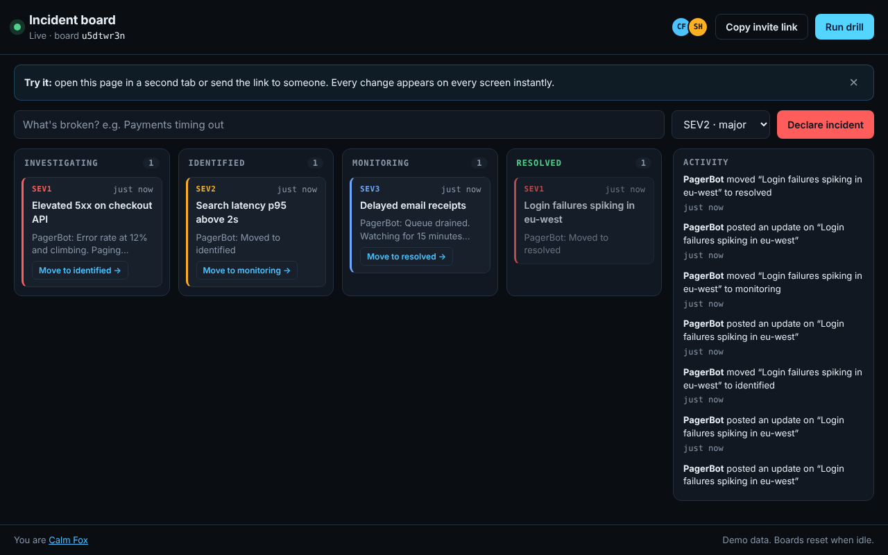

# 01 · Live incident board

[](https://github.com/DDSC0420/coding-portfolio/actions/workflows/live-incident-board.yml)

A real-time, multi-user incident board. Open it in two tabs, change something in one, and the other updates instantly. Built to show real-time systems work: WebSockets, shared state, conflict handling and reconnection.



## Try it (runs on your machine, about a minute)

With Python 3.12+:

```bash
git clone https://github.com/DDSC0420/coding-portfolio
cd coding-portfolio/01-live-incident-board
python -m venv .venv && source .venv/bin/activate   # Windows: .venv\Scripts\activate
pip install -r requirements.txt
uvicorn app.main:app
```

Or with Docker:

```bash
docker build -t incident-board . && docker run --rm -p 8000:8000 incident-board
```

Then open <http://localhost:8000>:

1. You land on a fresh board with demo incidents.
2. Open the same address in a second window, side by side.
3. Declare an incident, move a card, post an update. Watch the other window.
4. Press **Run drill** to play a scripted outage from first alert to resolved.

## What it does

- **Live sync.** Every change is broadcast to everyone on the board.
- **Presence.** See who else is on the board; rename yourself.
- **Conflict handling.** Each incident has a version number. If two people move the same card at once, the first wins and the second is told and shown the current state. Nothing is silently overwritten.
- **Reconnection.** If the connection drops the client retries with exponential backoff and jitter, then receives a full snapshot, so anything missed while offline is recovered.
- **Private boards.** Each visit gets its own board id. Only people with the link share it.
- **Works on a phone.** Columns swipe sideways; every action has a tap target, not only drag and drop.

## How it's built

```
browser (vanilla JS, no build step)
   │  WebSocket, JSON messages
   ▼
app/main.py    FastAPI: connections, rate limiting, broadcast
   │
   ▼
app/rooms.py   Board rules: pure Python, no framework, fully unit-tested
```

- **Server is the source of truth.** The browser never guesses; it renders what the server sends.
- **Rules are separate from transport.** `rooms.py` has no web imports, so every rule is tested without a server.
- **A slow client shouldn't stall the rest.** Each broadcast send has a timeout and runs concurrently. This one is by design and isn't covered by a test yet.

### Guard rails for a public demo

| Risk | Guard |
| --- | --- |
| Script injection through titles or notes | User text is only ever set with `textContent`; a strict Content-Security-Policy blocks inline script. Tested in a real browser. |
| Flooding | Per-connection token bucket, 2 KB message cap |
| Unbounded memory | Caps on boards, people per board, incidents, timeline length and text length; idle boards expire |
| Malformed input | Every field validated; bad messages get an error and the connection stays up |

## Tests

```bash
pip install -r requirements-dev.txt
pytest                              # everything
pytest tests/test_rooms.py          # rules only, no server
PLAYWRIGHT_CHANNEL=chrome pytest    # use your installed Chrome for the browser tests
```

49 tests in three layers:

- `test_rooms.py`: the rules (validation, version conflicts, caps, expiry)
- `test_socket.py`: the protocol over real WebSocket connections (broadcast, conflicts, late joiners, isolation between boards, rate limiting, the drill)
- `test_browser.py`: two real browser tabs against a real server staying in sync, a cut connection reconnecting and catching up, and the injection check

The browser tests need a browser: `python -m playwright install chromium`. They skip themselves if Playwright isn't installed.

## Honest scope

- **Local only for now.** There's no hosted demo; it runs on your machine. The Dockerfile is there for when it is hosted, but hasn't been built in CI.
- **One process, state in memory.** Boards vanish on restart and the app can't run as several instances. Scaling out would need shared state and a pub/sub layer such as Redis.
- **No accounts.** Anyone with a board link can edit that board. Fine for a demo, not for real incidents.
- **Last-writer-loses, not merging.** Conflicts are detected and refused, not merged.
- **Built with heavy AI assistance (Claude).** I set the brief and reviewed the design; the tests are what back each claim above.
