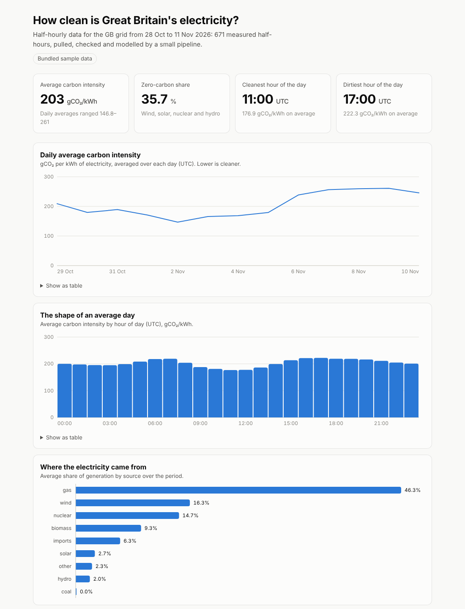

# 02 · UK grid data pipeline

[](https://github.com/DDSC0420/coding-portfolio/actions/workflows/uk-grid-pipeline.yml)

A small data pipeline that answers one question: **how clean is Great Britain's electricity, and when?** It pulls half-hourly public grid data, loads it into a database, models it with SQL, refuses to publish if the data fails its quality checks, and writes a one-page report. Built to show data engineering: extract, load, transform, test.



## Try it (runs on your machine, about a minute)

With Python 3.12+:

```bash
git clone https://github.com/DDSC0420/coding-portfolio
cd coding-portfolio/02-uk-grid-pipeline
python -m venv .venv && source .venv/bin/activate   # Windows: .venv\Scripts\activate
pip install -r requirements.txt

python -m gridwatch run --sample --open    # bundled data, no internet needed
python -m gridwatch run --open             # live data from the public API
```

You'll see each stage report in:

```
1/5 extract   2026-10-28T08:35Z to 2026-11-11T08:35Z from the Carbon Intensity API
2/5 load      672 intensity rows, 6048 generation rows
3/5 transform 6 SQL models
4/5 check     6/6 data quality checks passed
5/5 report    site/index.html
```

Run it again later and it only fetches what's new.

## How it works

```
Carbon Intensity API ──► extract.py ──► load.py ──► sql/*.sql ──► checks.py ──► report.py
   (public, no key)      windows,       DuckDB,     staging        6 gates       one HTML
                         retries        upserts     + marts                      file
```

| Stage | What it does | The care taken |
| --- | --- | --- |
| **Extract** | Requests half-hourly intensity and generation mix | Long ranges are split into 7-day windows. Timeouts, connection errors, 429 and 5xx are retried with exponential backoff; other 4xx fail fast. |
| **Load** | Lands raw records in DuckDB | Idempotent: each half-hour is a primary key, so re-runs and overlapping windows never duplicate. A whole batch is validated before anything is written, in one transaction. A re-fetch can fill in a late "actual" value but never erase one. |
| **Transform** | Numbered SQL files build staging views, then marts | Plain SQL you can read top to bottom. Forecast-only periods are excluded from every mart. |
| **Check** | Six data quality checks | Any failure exits non-zero and **no report is published**. |
| **Report** | One self-contained HTML page | No server, no CDN. Works offline, in light and dark mode, on a phone. Every chart has a table view. |

**Incremental by default.** The first run backfills 14 days. Later runs fetch from the last loaded half-hour, minus a one-day overlap, because measured values arrive after forecasts. `--days N` forces a backfill.

## The data

Source: the [Carbon Intensity API](https://carbonintensity.org.uk/) from the National Energy System Operator (NESO). Free, no key.

- **Carbon intensity** is grams of CO₂ per kWh of electricity. The report uses measured ("actual") values only.
- **The daily chart shows complete days only** (at least 44 of 48 half-hours). The first and last day of a fetch are usually partial and would give misleading averages.
- **Zero-carbon share** here means wind, solar, nuclear and hydro. Biomass and imports are deliberately not counted.
- All times are UTC.

`sample/` holds a real snapshot of API responses (28 Oct to 11 Nov 2026) so the pipeline runs with no network. The screenshot above is that sample.

## Tests

```bash
pip install -r requirements-dev.txt
pytest
PLAYWRIGHT_CHANNEL=chrome pytest    # use your installed Chrome for the browser tests
```

60 tests, none of which touch the network:

- `test_extract.py`: windowing, retry and backoff behaviour, bad responses
- `test_load.py`: idempotency, late-arriving values, malformed records, all-or-nothing batches
- `test_transform_and_checks.py`: every mart against hand-computed answers; every quality check made to fail
- `test_pipeline.py`: the whole pipeline against a fake API, including the incremental second run
- `test_report_browser.py`: the report opened in a real browser at desktop and phone widths

The live API path is exercised separately by a manual GitHub Actions job (`live`) that runs the real pipeline against the real API. The example output above is from that job.

## Honest scope

- **Small data.** A few thousand rows on one machine. DuckDB and plain SQL are the right size for this; it says nothing about running Spark or a warehouse.
- **No scheduler.** You run it, or cron does. There's no orchestration, alerting or backfill tooling.
- **One source.** If the API changes shape the load step will reject the data loudly, but nothing adapts by itself.
- **The 7-day window is a cautious choice,** not a documented API limit I've pinned down.
- **Built with heavy AI assistance (Claude).** I set the brief and reviewed the design; the tests back the claims above.
