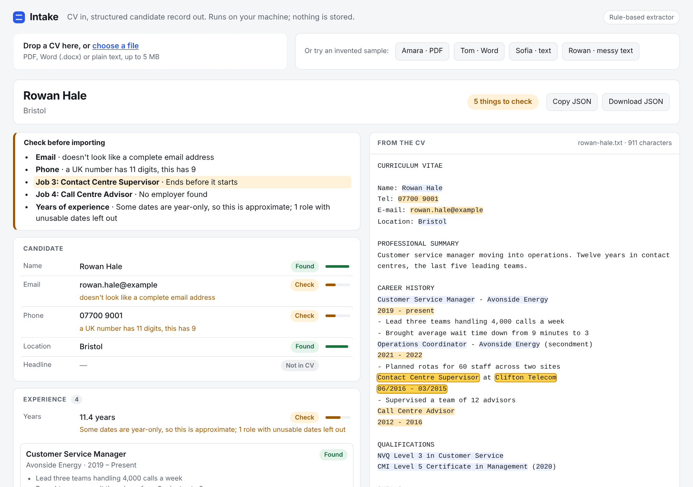

# 03 · Intake: CV to structured record

[](https://github.com/DDSC0420/coding-portfolio/actions/workflows/intake.yml)

Drop in a CV (PDF, Word or plain text) and get back a clean, validated candidate record as JSON: contact details, jobs with dates, education, skills and years of experience. **Every value points back to the exact words in the CV it came from, and nothing that isn't in the CV gets into the record.** Doubtful values are kept but flagged with a plain reason, instead of being guessed. Built to show AI extraction done carefully: schema validation, evidence, and review flags.



## Try it (runs on your machine, about a minute)

With Python 3.12+. No API key needed:

```bash
git clone https://github.com/DDSC0420/coding-portfolio
cd coding-portfolio/03-intake
python -m venv .venv && source .venv/bin/activate   # Windows: .venv\Scripts\activate
pip install -r requirements.txt
python -m intake serve --open
```

Then, at <http://127.0.0.1:8000>:

1. Press **Rowan · messy text** to see a CV with problems: each one is listed with its reason.
2. Click any field, job or skill. The exact text it came from lights up in the CV on the right.
3. Press **Amara · PDF** for a clean CV ("Ready to import"), or drop in a CV of your own.
4. **Download JSON** gives you the record.

From the command line:

```bash
python -m intake extract samples/tom-brennan.docx   # print one record as JSON
python -m intake eval                              # score against hand-labelled answers
```

Your CV stays on your machine: it's processed in memory and nothing is written to disk. (If you switch on the optional LLM mode below, the CV text is sent to that provider.)

## What you get back

Every field has a value, a status (`found`, `needs_review` or `missing`), a confidence, the evidence and, when something's doubtful, a reason:

```json
"phone": {
  "value": "07700 9001",
  "status": "needs_review",
  "confidence": 0.4,
  "evidence": [{ "start": 40, "end": 50, "text": "07700 9001" }],
  "note": "a UK number has 11 digits, this has 9"
}
```

A clean UK number comes back in one standard form (`+447700900123`). The whole record also carries `needs_review`, a `review` list of everything to check, and `rejected`: values an extractor proposed that weren't in the CV and were thrown away.

## How it works

```
file ──► readers.py ──► clean text ──► rules.py (default, no key) ──► Draft ──► validate.py ──► Result
         PDF, DOCX,                    llm.py (optional, env var)    quotes     evidence, dates,     JSON
         text by content                                             only       phones, totals, flags
```

The design rule: **extractors only point at text; code does the interpreting.** Both extractors return a `Draft` of strings quoted from the CV. Then the same validation runs on either:

| Step | What it does |
| --- | --- |
| **Grounding** | Every value must be found in the CV text, or it's discarded and listed under `rejected`. The value kept is the CV's own text, not the extractor's version of it. |
| **Interpreting** | Dates, phone numbers and years of experience are worked out by code from the quoted text, never taken from a model. Overlapping jobs count once; impossible ranges are left out of the total, and the total says so. |
| **Flagging** | A phone number with the wrong number of digits, an email with no domain ending, a job that ends before it starts, a role with no employer: each keeps its value, gets `needs_review` and a reason. Missing stays missing. |
| **Schema** | Pydantic models. The schema itself refuses a value with no evidence, so "nothing invented" is enforced by the types as well as the code. |
| **Personal data** | Addresses are cut down to town and county: house numbers, streets and postcodes are dropped. |
| **Files** | The type is decided by the file's first bytes, not its name. Password-protected and damaged PDFs, scans with no text, old `.doc` files and Word files that unzip to more than 50 MB are refused with a clear message. 5 MB and 10 page limits. |

**Finding the right copy of a value.** A job title often appears twice, once in the summary and once in the job history. Each role's dates are found first and its title and employer are matched nearest to them. Skills are matched as a list, so "Terraform" points at the skills section, not a job bullet that happens to mention it.

**The rule-based extractor** (`intake/rules.py`) is plain Python with no framework imports. It knows common UK CV headings, three ways of laying out a job (one line with separators, title / employer / dates on separate lines, "title at employer"), labelled fields like `Tel:` and Word quirks such as bullets that live in list formatting and names in the page header.

### Optional: use an LLM instead

```bash
export INTAKE_LLM=anthropic ANTHROPIC_API_KEY=...   # or INTAKE_LLM=groq GROQ_API_KEY=...
export INTAKE_LLM_MODEL=...                          # optional; defaults in intake/llm.py
python -m intake serve
```

The model is asked to copy values exactly and return JSON. Its reply goes through the same validation, and any confidence it tries to give itself is ignored. If the call fails or the reply doesn't fit the schema, Intake falls back to the rule-based extractor and says so in `warnings`. It uses the standard library for HTTP, so there's no SDK to install.

## The samples and the scorecard

`samples/` holds four **invented** people: emails use the reserved `example.com/.org/.net` domains and phone numbers come from Ofcom's range set aside for drama (07700 900xxx). The PDF and Word files are generated by `scripts/build_samples.py`.

| Sample | Shows |
| --- | --- |
| `amara-osei.pdf` | A clean PDF, one-line job layout, labelled skill groups |
| `tom-brennan.docx` | Word: name in the page header, list bullets, skills in a table, all-caps name |
| `sofia-marlowe.txt` | A graduate with no phone, location or headline: missing stays missing |
| `rowan-hale.txt` | A messy CV: short phone number, broken email, a job ending before it starts, no employer |

Each has hand-labelled answers in `samples/expected/`, written from the CV, not copied from Intake's output. `python -m intake eval` checks 11 fields per CV, including *which fields were flagged*, because catching a problem counts as part of the right answer:

```
44/44 fields correct across 4 invented CVs
```

## Tests

```bash
pip install -r requirements-dev.txt
pytest
PLAYWRIGHT_CHANNEL=chrome pytest    # use your installed Chrome for the browser tests
```

126 tests, none of which touch the network:

- `test_text_dates_phones.py`: text cleaning, date formats people write, overlap-aware year totals, phone normalisation
- `test_readers.py`: PDF, Word and text reading, plus every refusal (zip bomb, password, scan, `.doc`, image)
- `test_rules.py`: each extraction rule on its own, including the three job layouts and address trimming
- `test_validate.py`: grounding, flags, the schema refusing a value with no evidence, and a check that every value in every sample points at real CV text
- `test_llm.py`: the LLM path against a fake API: invented values discarded, a CV's injected instructions can't add values, failures fall back to the rules, the key never leaks
- `test_samples.py`: the scorecard and the command line
- `test_api.py`: uploads, size limits, security headers, sample names that can't be used to reach other files
- `test_browser.py`: the page in a real browser: review flags, evidence highlighting, upload and download, CV text that tries to run script, a phone-sized screen

The browser tests need a browser: run `python -m playwright install chromium` once. Until you do, they skip themselves and say so.

## Honest scope

- **Tuned on four invented CVs.** The 44/44 is a regression check, not an accuracy figure. Real CVs are far messier: two-column PDFs (the text can come out interleaved), layouts built from tables, creative templates. Expect the rules to miss things on those, and the flags to catch only some of it.
- **Grounding stops invention, not misdirection.** A value must appear in the CV, but a CV can still contain misleading text (say, a fake name in a hidden line) and an extractor can pick it. The evidence highlight is how a person spots that, and there's a test documenting this limit.
- **The LLM path is only tested against a fake API.** It hasn't been run against Anthropic or Groq in CI (there's no key there), and default model names go stale; set `INTAKE_LLM_MODEL` if one is retired.
- **UK-shaped.** Phone validation, the list of about 90 towns used to spot an unlabelled location, and the headings it knows are all UK-centric. A location is only found if it's labelled or one of those towns.
- **No OCR.** Scanned CVs are refused, not read.
- **It stops at JSON.** Mapping the record into a particular CRM or ATS isn't part of this.
- **Local only, no accounts.** Don't expose it to the internet as it is. "Nothing is stored" is a description of the code, not a data-protection compliance claim.
- **Built with heavy AI assistance (Claude).** I set the brief and reviewed the design; the tests back the claims above.
