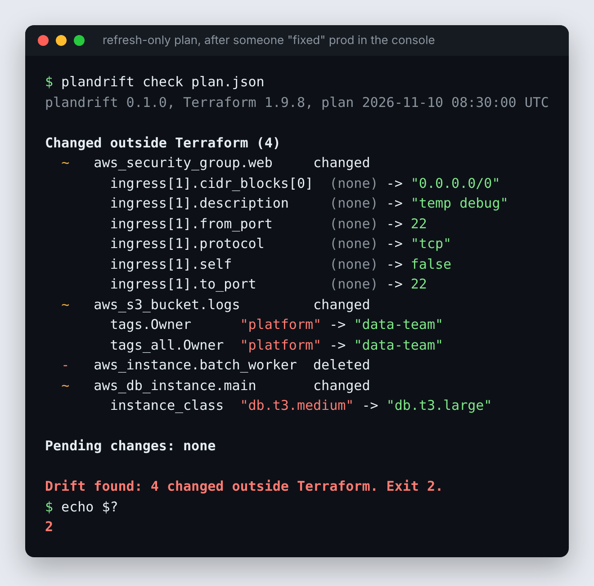

# 04 · plandrift: Terraform drift report

[](https://github.com/DDSC0420/coding-portfolio/actions/workflows/terraform-drift.yml)

Someone "fixes" production in the cloud console on a Friday. Terraform still thinks the old settings are live. **plandrift reads a Terraform plan and tells you, in plain terms, what was changed outside Terraform and what applying the plan would do**, as a terminal table, a Markdown report for a pull request or job summary, or JSON. Its exit code makes it a CI gate: 0 nothing found, 2 found, 1 error. Sensitive values are never printed.

It's a real installable tool: a Python package with a console command and no dependencies, built and tested on Linux, macOS and Windows with Python 3.10 to 3.13, released as a wheel on GitHub Releases, and usable as a GitHub Action. Built to show packaging and release engineering, on top of Terraform.



## Try it (no Terraform, no cloud account, about a minute)

With Python 3.10+:

```bash
git clone https://github.com/DDSC0420/coding-portfolio
cd coding-portfolio/04-terraform-drift
python -m venv .venv && source .venv/bin/activate   # Windows: .venv\Scripts\activate
pip install .
plandrift check examples/console-changes.json
```

That's the picture above. The bundled examples are plan JSON from an invented AWS estate where someone made changes by hand. Then:

```bash
plandrift check examples/drift-and-changes.json                 # drift plus pending changes, secrets masked
plandrift check examples/drift-and-changes.json -f markdown      # the PR-comment version
plandrift check examples/console-changes.json --ignore '*:tags_all' --ignore 'aws_instance.*'
plandrift check examples/no-drift.json; echo $?                  # 0
```

`examples/real/` holds plan JSON from a real Terraform 1.17 run (committed by the end-to-end CI job below), and the tests check plandrift against it.

## Install it as a tool

Straight from GitHub, no clone needed:

```bash
pipx install "git+https://github.com/DDSC0420/coding-portfolio#subdirectory=04-terraform-drift"
# or: pip install "git+https://github.com/DDSC0420/coding-portfolio#subdirectory=04-terraform-drift"
```

Releases put a ready-built wheel and sdist on the [Releases page](https://github.com/DDSC0420/coding-portfolio/releases) (tags `drift-vX.Y.Z`), installable with `pipx install <wheel URL>`. It isn't on PyPI.

## Use it on your Terraform

```bash
terraform plan -refresh-only -out=plan.out      # refresh-only: just "what changed outside Terraform?"
terraform show -json plan.out > plan.json
plandrift check plan.json
```

Or let plandrift run Terraform for you in the current directory:

```bash
plandrift run                                   # terraform plan -refresh-only, then report
plandrift run --full-plan -- -var-file=prod.tfvars
plandrift run --terraform-bin tofu              # OpenTofu
```

A normal plan (no `-refresh-only`) gives you both sections: the drift Terraform found, and what applying would do (often: put the drift back).

### In CI

| Exit code | Meaning |
| --- | --- |
| `0` | Nothing found (per `--fail-on`) |
| `2` | Found: drift, or pending changes (per `--fail-on`) |
| `1` | Error: unreadable input, Terraform failed, bad arguments. Never 2. |

`--fail-on any` (default) treats drift and pending changes as findings, like `terraform plan -detailed-exitcode`. `--fail-on drift` only fails on changes made outside Terraform. `--fail-on never` always exits 0 and just reports.

A nightly drift check with the GitHub Action, which writes the Markdown report to the job summary:

```yaml
on:
  schedule: [{ cron: "0 6 * * *" }]
jobs:
  drift:
    runs-on: ubuntu-latest
    steps:
      - uses: actions/checkout@v4
      - uses: hashicorp/setup-terraform@v3
        with: { terraform_wrapper: false }
      - run: terraform init -input=false && terraform plan -refresh-only -out=plan.out && terraform show -json plan.out > plan.json
        # (plus your cloud credentials)
      - uses: DDSC0420/coding-portfolio/04-terraform-drift@main   # or pin a release tag
        with:
          plan: plan.json
          fail-on: drift
          ignore: |
            *:tags_all
```

Outputs: `exit-code`, `drift-count`, `change-count`, `report-json`, `report-markdown`. To post the report as a PR comment: `gh pr comment "$PR" --body-file "${{ steps.drift.outputs.report-markdown }}"`.

## Options

| Option | |
| --- | --- |
| `-f, --format table\|markdown\|json` | Terminal table (default), Markdown, or JSON (schema below) |
| `-o, --output FILE` | Write the report to a file instead of stdout |
| `--fail-on any\|drift\|never` | What makes the exit code 2 |
| `--ignore RULE` | Leave something out. `ADDRESS` drops a resource, `ADDRESS:ATTRIBUTE` drops an attribute (and everything under it). `*` and `?` are the only wildcards, so `aws_instance.web[0]` means exactly that. Repeatable. An update whose every difference is ignored drops out; a deletion or replacement never does. |
| `--color auto\|always\|never` | Colours in the table. `auto` means only on a terminal, and respects `NO_COLOR`. |
| `run --chdir DIR --terraform-bin BIN --full-plan -- ARGS` | Run Terraform first. `PLANDRIFT_TERRAFORM` sets the default binary. |

## What it reports

- **Changed outside Terraform** (`resource_drift`): updated, with each changed attribute and its before and after value, or deleted.
- **Pending changes** (`resource_changes`): create, update in place, replace (`-/+`, with the attributes that force it), delete, move, import, forget, plus Terraform's reason when it gives one ("tainted", "removed from the configuration").
- **Sensitive values** are shown as `(sensitive)` in every format, including JSON, so a report is safe to paste into a PR. If a value is marked sensitive on either side, both sides are hidden. If the type of a value changed and anything inside it was sensitive, the whole value is hidden.
- **Values known only after apply** show as `(known after apply)`, not as null.
- Data-source reads and no-op entries are left out: they aren't changes to infrastructure.

The JSON report (`schema_version: 1`) has `summary` (counts, exit code, headline), and `drift` and `changes` lists of `{address, type, action, notes, attributes}`, where each attribute is `{path, path_parts, kind, before, after, sensitive, unknown, forces_replacement}`.

## How it works

```
plan.json ──► plan.py ──► diff.py ──► report.py ──► render.py ──► table / markdown / json + exit code
              which        each         ignore         never sees
              resources,   attribute    rules,         a secret: diff.py
              what action  that differs exit code      already replaced it
```

| Module | Job |
| --- | --- |
| `plan.py` | Reads plan JSON into plain records. Turns Terraform's action lists into one word (`["delete","create"]` is a replace). Refuses state JSON, binary plan files, newer formats and errored plans with a message that says what to do. |
| `diff.py` | Walks before and after together and lists every leaf that differs, as a path like `ingress[1].cidr_blocks[0]`. Applies the sensitive and unknown marks on the way, so a secret never leaves this module. |
| `report.py` | Ignore rules (a small glob of its own, since addresses contain `[ ]`), and the exit code. |
| `render.py` | The three formats. Markdown values are HTML-escaped inside `<code>`, so a value with a `|` or `<script>` can't break the table or inject anything. |
| `terraform.py` | `plandrift run`: `terraform plan -out` to a temp file, then `terraform show -json`. |
| `cli.py` | Arguments and exit codes. argparse's own usage-error exit code is 2, which here would mean "drift found", so usage errors exit 1. |

Everything except `cli.py` and `terraform.py` is pure functions with no I/O, tested directly. No runtime dependencies, so the wheel is 12 files and installs anywhere.

## How it's tested

Every push to this folder runs the [workflow](../.github/workflows/terraform-drift.yml):

| Job | What it proves |
| --- | --- |
| **test** | 178 tests: action mapping, attribute diffs, sensitive and unknown handling, ignore rules, the three formats, exit codes, the CLI end to end, `plandrift run` against a fake Terraform. One test walks every example plan, collects every value marked sensitive, and checks none appears in any output format. |
| **build** | Builds the wheel and sdist, `twine check --strict`, installs the sdist into a clean venv. |
| **smoke** ×12 | Installs the built wheel (not the source) into a clean venv on Ubuntu, macOS and Windows × Python 3.10, 3.11, 3.12, 3.13, and checks the command: version, exit codes 0/1/2, all formats, stdin. |
| **e2e** ×3 | Real Terraform 1.9.8, latest Terraform, and latest OpenTofu. Applies a small config ([`e2e/main.tf`](e2e/main.tf)) using free providers (local files, random, and a throwaway Consul dev server), changes things behind Terraform's back (edits a file, deletes one, flips a Consul key, adds another), then checks plandrift reports exactly that, via both `check` and `run`. The Markdown report lands in the job summary. |
| **action** ×3 | Runs the composite Action on Ubuntu, macOS and Windows and checks its outputs, and that drift fails the step when it should. |

Releases: the [release workflow](../.github/workflows/terraform-drift-release.yml) runs on a pushed `drift-vX.Y.Z` tag, or from the Actions tab ("Run workflow" tags `main` with the package version). It refuses a version with no changelog entry, a tag that doesn't match the package, or a version that's already released. Then it runs the tests, builds, creates a GitHub Release with the wheel and sdist, and installs from the release URL on all three OSes. See [CHANGELOG.md](CHANGELOG.md).

## Honest scope

- **It reports, it doesn't fix.** It never applies, imports or edits state.
- **The AWS examples are hand-written** in Terraform's documented plan format, to show realistic drift without a cloud account. The plans in `examples/real/` and the e2e job are real, but use local, random and Consul providers. It hasn't been run against a real AWS, Azure or GCP estate.
- **Provider quirks show through.** The local provider treats an edited file as deleted, so plandrift reports it as deleted. Drift is only as accurate as what each provider reads back.
- **Lists and sets are compared by position.** An element inserted in the middle of a list shows as several changed attributes rather than one added element.
- **All drift is reported**, not only the drift that affects the plan (Terraform's `relevant_attributes`). Use `--ignore` for noisy attributes.
- Output value changes aren't reported. Not on PyPI. Version 0.1.0: the JSON schema may change before 1.0, and `schema_version` will say so.

## Development

```bash
pip install -r requirements-dev.txt -e .
ruff check . && pytest
python -m build                            # dist/plandrift-X.Y.Z-py3-none-any.whl and .tar.gz
python scripts/screenshot.py               # regenerate docs/terminal.png (needs playwright, pillow, Chrome)
e2e/run.sh                                 # real Terraform + a Consul dev agent on :8500
```
