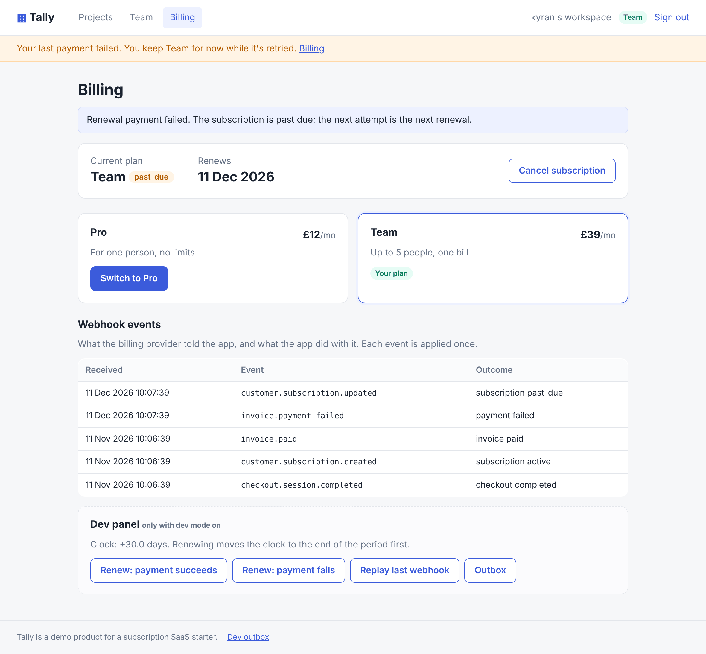
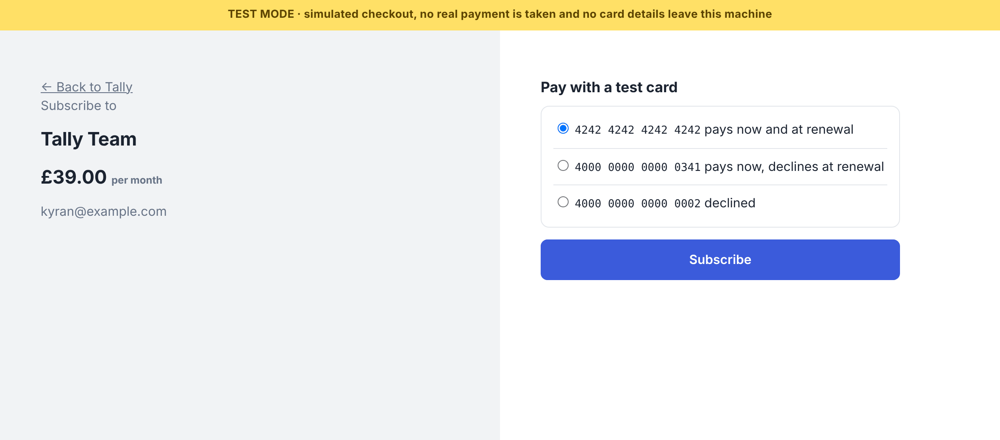

# 05 · Tally: subscription SaaS starter

[](https://github.com/DDSC0420/coding-portfolio/actions/workflows/saas-starter.yml)

The parts of a subscription product that are easy to get subtly wrong, built properly and tested: **accounts, plans with limits, checkout, renewals, failed payments, cancellation, and team seats**, kept in step with a billing provider through signed webhooks. The product behind the paywall is deliberately tiny (Tally, a list of projects) so the subscription machinery is what you see.

It runs entirely on your machine. There's no payment account and no API key: a built-in **test billing provider** plays the part of Stripe. It has its own checkout page and records, and it reports every change as a Stripe-format event, signed the way Stripe signs them, through the same handler a real webhook would hit.



## Try it (runs on your machine, about a minute)

With Python 3.12+:

```bash
git clone https://github.com/DDSC0420/coding-portfolio
cd coding-portfolio/05-saas-starter
python -m venv .venv && source .venv/bin/activate   # Windows: .venv\Scripts\activate
pip install -r requirements.txt
python -m tally serve --open
```

Then, at <http://127.0.0.1:8000>:

1. **Start free** with any email (nothing is sent anywhere). Add projects until the Free plan stops you at 3.
2. **Billing → Upgrade to Pro**. The test checkout opens; press **Subscribe**. You're on Pro, export works, and the billing page lists the three webhook events that made it so.
3. In the **dev panel**, press **Renew: payment fails**. The clock jumps to the renewal date, the payment fails, and you're *past due*: a banner, but you keep Pro while it's retried. **Renew: payment succeeds** puts it right. Two failures in a row end the subscription.
4. **Replay last webhook** sends the last event again: it's recognised and ignored.
5. **Cancel subscription**: you keep Pro until the period ends (renew to get there), then drop to Free, projects kept.
6. Upgrade to **Team** and invite someone from the **Team** page. "Emails" (invites, password resets) land in the **Dev outbox**; open the link in a private window to join.



Test cards, as in Stripe's test mode: `4242 4242 4242 4242` pays now and at renewal, `4000 0000 0000 0341` pays now and declines at renewal, `4000 0000 0000 0002` is declined. Data lives in `.data/tally.db`; `--reset` starts over, `--no-dev` hides the dev panel and outbox.

## What's in it

| Area | What it does |
| --- | --- |
| **Accounts** | Email and password, hashed with scrypt (salt per password, parameters stored with the hash). Server-side sessions: the cookie holds a random token, the database only its SHA-256, so sign-out really ends the session and a leaked database can't be replayed. HttpOnly, SameSite=Lax, Secure over HTTPS. |
| **CSRF** | Every form carries a token that must match a signed, HttpOnly, SameSite=Strict cookie. Sign-in and sign-up forms too. |
| **Abuse** | Sign-in limited to 5 tries per email and 30 per address per 15 minutes, with `Retry-After`. Wrong password and unknown email get the same message and take the same time. Password reset never says whether an account exists, and is rate limited. |
| **Password reset** | Emailed link (to the dev outbox), single use, 30 minutes, stored as a digest. Using it signs out every session. |
| **Plans** | Free (3 projects), Pro (unlimited, CSV export), Team (Pro plus 5 seats). Every limit is checked on the server in [`plans.py`](tally/plans.py); the pages only reflect it. Posting a form the page hid still gets `402`. |
| **Subscriptions** | A pure state machine in [`subscriptions.py`](tally/subscriptions.py): active, past due (paid features kept as a grace period), cancel at period end and resume, plan change, ended. Events older than the last one applied are ignored; events for another subscription are ignored. |
| **Webhooks** | [`webhooks.py`](tally/webhooks.py): Stripe's scheme (`t=…,v1=` HMAC-SHA256 of `t.body`), checked against the raw bytes before parsing, with a 5-minute window so a captured request can't be replayed. Each event id is applied once, enforced by the database's primary key inside the same transaction. Unknown types get `200` and are ignored, so the provider doesn't retry forever. |
| **Teams** | Workspaces are the billing unit. The owner invites by email; pending invites count against seats; invite links are single use, 7 days, and only for the invited address. Only the owner can change billing or people. Removed members fall back to their own workspace. |
| **Test provider** | [`billing/fake.py`](tally/billing/fake.py) keeps its own tables and never shares state with the app except through signed events. It does checkout, plan changes, cancel and resume, renewals that succeed or fail, gives up after two failed renewals, and can replay its last event. No card number is stored or logged: the test card only picks a behaviour. |
| **Pages** | Server-rendered (FastAPI + Jinja2), no JavaScript needed. A strict Content-Security-Policy with no inline scripts or styles, `X-Frame-Options: DENY`, `no-store` on signed-in pages. CSV export neutralises spreadsheet formulas in project names. |

The rule-holding modules (`security.py`, `plans.py`, `subscriptions.py`, `webhooks.py`) are plain Python with no framework imports and are tested directly. [`store.py`](tally/store.py) holds every SQL query; the schema is a numbered migration in [`migrations/`](tally/migrations/).

## How it's tested

131 tests, run in CI on every push:

| Layer | Examples |
| --- | --- |
| **Rules** (52) | scrypt round trip, token digests, signed values, CSRF pairs, rate-limit windows; effective plan for every status; every webhook signature failure (missing, wrong secret, tampered body, re-serialised JSON, outside the window, several `v1`s); every state transition including out-of-order, other-subscription and resubscribe. |
| **App** (78) | Through HTTP with a controllable clock: sign-up rules, session storage and sign-out, CSRF on every kind of form, both rate limits, open-redirect attempts on `next`, reset links (no enumeration, single use, expiry, signs out other devices), limits enforced when the form is bypassed, checkout with each test card, renewals, two-failure cancellation, cancel and resume, plan switch, replay, the webhook endpoint called the way an outside provider would, seats, invites for the wrong person, owner-only actions, workspace switching, XSS and CSV-formula escaping, security headers, restart persistence. |
| **Browser** (1) | Playwright in real Chromium: sign up, hit the limit, upgrade through checkout, export, a failed renewal and its banner, replay, recovery, cancel, back to Free. Fails on any console error. |

## Honest scope

- **No real payment provider is wired in.** The webhook handler speaks Stripe's signature scheme and event shapes, and the provider sits behind four calls (`start_checkout`, `change_plan`, `cancel`, `resume`), but it has only run against the built-in test provider. Wiring Stripe means implementing those four calls against its API and pointing its webhooks at `/webhooks/billing`.
- **The test provider delivers webhooks instantly, in the same request.** A real one is asynchronous and may be slow or retry, so a real checkout return page would need to show "processing" until the event lands.
- **Simplified billing:** no trials in the flow (the state machine handles `trialing`), no proration on plan changes, no taxes, invoices or receipts, no card update page, and dunning is "two failed renewals and it ends".
- **Single process:** rate limits live in memory, and SQLite is the database. Email is a dev outbox, not SMTP. No email verification, MFA or account deletion.
- Plan downgrades don't remove members above the new seat count; they just block new invites.

## Development

```bash
pip install -r requirements-dev.txt
ruff check . && pytest                       # browser test runs if Playwright is installed
python -m playwright install chromium        # or: PLAYWRIGHT_CHANNEL=chrome pytest
python scripts/screenshot.py                 # regenerate docs/*.png from the running app
```
