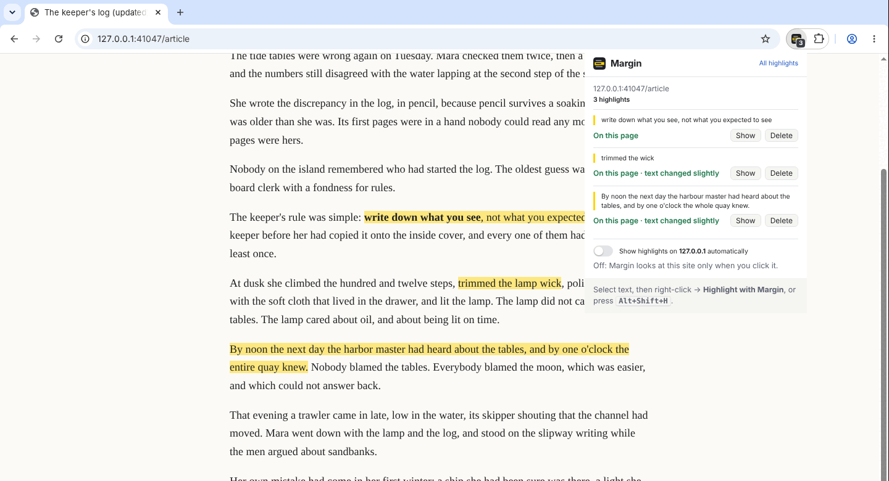
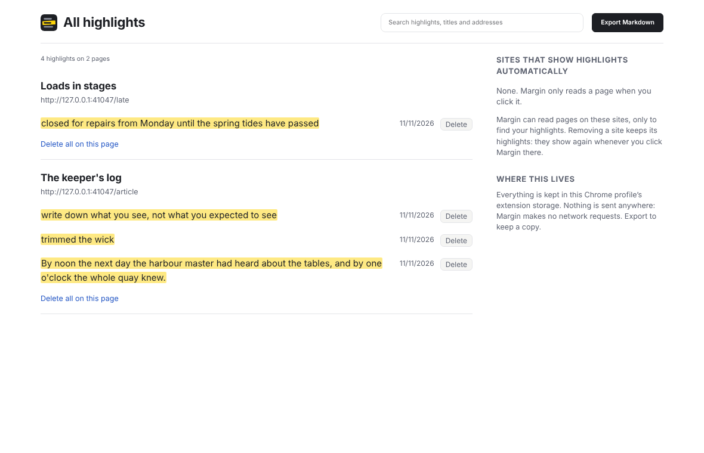

# 06 · Margin: highlights that stay put

[](https://github.com/DDSC0420/coding-portfolio/actions/workflows/chrome-extension.yml)

A Chrome extension (Manifest V3). Select text on any page, save it with a keyboard shortcut or the right-click menu, and it's highlighted again when you come back, **even if the page has been edited since**. When a passage has changed too much to be sure, Margin says "not found" instead of highlighting the wrong words.

It can't read any website when you install it. It looks at a page only when you ask it to, or on sites you have switched on yourself, through Chrome's own prompt. Everything stays in your browser.



## Try it (no store, no account, about a minute)

```bash
git clone https://github.com/DDSC0420/coding-portfolio
```

1. In Chrome, open `chrome://extensions`, switch on **Developer mode** (top right), click **Load unpacked** and pick the `coding-portfolio/06-chrome-extension/extension` folder.
2. On any article, select a sentence and press **Alt+Shift+H** (or right-click → **Highlight with Margin**). It turns yellow.
3. Reload the page. Nothing: by default Margin doesn't read pages on its own. Click Margin's toolbar button (puzzle piece → Margin, or **Alt+Shift+M**): the highlights come back and the popup lists them.
4. In the popup, switch on **Show highlights on this site automatically**. Chrome asks for permission for that one site; allow it, and from then on its highlights come back by themselves.
5. **All highlights** opens the library: search everything, delete, and **Export Markdown**.

Works in Chrome and other Chromium browsers from version 116. On a Mac the shortcuts are Option+Shift+H and Option+Shift+M; change them at `chrome://extensions/shortcuts`.



## How it finds a passage again

Saving records the words you selected plus up to 32 characters either side (the W3C Web Annotation "text quote" selector) and where they were (a position, used only to break ties). All of it is measured in the page's text with runs of whitespace collapsed, so re-flowed lines, `&nbsp;` or a link turned into plain text make no difference.

When you come back, [`lib/anchor.js`](extension/lib/anchor.js) tries, in order:

| Step | Finds it when | Popup says |
| --- | --- | --- |
| **Exact** | the words are still there. Several copies? The one whose surroundings match best. | On this page |
| **Close match** | at most a quarter of the characters have been edited (a typo fixed, "harbour" → "harbor"). Long passages are matched by their first and last 32 characters, then checked whole. | On this page · text changed slightly |
| **Context** | the words either side are intact and what's between them is still at least 60% the same ("trimmed the wick" → "trimmed the lamp wick"). | On this page · text changed slightly |
| None of those | the passage was deleted or rewritten. | Not found: the page has changed |

A wrong highlight is worse than none, so a short passage (under 20 characters) is only accepted when its surroundings agree too: a highlighted "the moon" won't jump to a different "the moon" after its sentence is rewritten.

Highlights are drawn with the CSS Custom Highlight API, which paints ranges of text without touching the page's elements. Nothing is wrapped or inserted, so the page's own scripts and layout never notice, and a page that re-renders doesn't wipe them out.

## Permissions, and why each one

| Asked for | When | Why |
| --- | --- | --- |
| `activeTab` | at install | When you press the shortcut, use the menu or click the button, Chrome lets Margin into **that one tab**, until you navigate away. |
| `contextMenus` | at install | The "Highlight with Margin" item, shown only when text is selected. |
| `storage` | at install | Highlights are kept in `chrome.storage.local`, in this browser profile. |
| `scripting` | at install | To put Margin's script on a tab you opened up, and to register it for the sites you chose. |
| one site's pages | only if you switch it on | "Show automatically" asks Chrome for `https://that-site/*` and nothing wider ([`optional_host_permissions`](extension/manifest.json) plus `chrome.scripting.registerContentScripts`). Switch it off in the popup or the library and the permission is handed back. |

What it doesn't do, each backed by a test: no site access at install and nothing that runs on pages by default; no network requests anywhere in its code; no remote code (no inline scripts, the default extension Content-Security-Policy); nothing exposed to web pages (a page can't message Margin or load its files). Margin's script on a web page can't open its storage at all (storage is locked to Margin's own pages); it asks the service worker, which takes the page's address from Chrome rather than from the message, so it only ever gets and saves its own page's highlights, and only Margin's own pages can delete.

## How it's tested

**71 tests** in CI on every push: 53 unit tests and an 18-step browser run.

| Layer | What it covers |
| --- | --- |
| **Unit** (`node --test`, no dependencies) | Anchoring on plain strings: 300 random selections round-trip exactly; repeated phrases resolved by context; text added above; re-flowed whitespace; a typo fixed inside; one word changed in a short passage; a long passage edited in the middle; deleted and rewritten passages reported lost; a decoy copy not picked up; a lost passage on a 200,000-character page given up within the time limit. Storage: duplicates, 20 simultaneous saves all kept, selectors from the page validated. Page addresses, search, Markdown escaping. Manifest guards: the exact permission list, no network code, every referenced file present. |
| **Browser** (Playwright, a real Chrome window) | The whole extension used the way a person uses it, with nothing pre-granted: shortcuts pressed at the operating-system level with `xdotool` (which is what makes Chrome grant `activeTab`), Chrome's own permission prompt answered with the keyboard (deny, then allow), the real toolbar popup driven over the DevTools protocol. Saves across links and emphasis; nothing happens on reload by default; the popup shows them; edited page found, rewritten passage reported lost; content that loads late; delete from the popup and the library; Markdown export compared with a hand-written file; a content script trying to read storage, delete, or save under another address is refused. Painted highlights are checked twice: in the page's highlight registry, and as yellow pixels in a screenshot. |

The pixel check exists because of a real bug: every other test passed while the screenshot showed no yellow at all. Chrome ignores `::highlight()` rules in a stylesheet injected with the "user" origin, so the highlights existed but were never drawn. The fix was one argument; the test makes sure it stays fixed.

## Honest scope

- **Not on the Chrome Web Store.** Publishing needs a developer account and a one-off fee; for now you load it unpacked. CI builds the zip a store submission would use (download it from any run's artifacts).
- **Text in the page only:** not images, Chrome's PDF viewer, iframes, shadow DOM or text inside form fields.
- **Single-page apps** that change the address without reloading: the new page's highlights appear after a reload or a click on Margin.
- One page is one address (ignoring `#fragments` and tracking parameters like `utm_source`). The same article at two addresses is two pages.
- One colour, no notes, no sync between computers (`storage.local`, not `storage.sync`, whose limits are small), no importing an export.
- Finding a lost passage costs up to about 150 ms on a very long page (200,000 characters); most articles are a fraction of that.
- The page itself can see which of its passages are highlighted (the browser's highlight registry is shared with the page). It's the page's own text, but worth knowing.
- Tested in Chrome for Testing and Playwright's Chromium on Linux. Edge, Brave, macOS and Windows should behave the same but haven't been checked.

## Layout

```
extension/            the folder you load: no build step, plain JavaScript
  manifest.json
  background.js       service worker: saving, the per-site registration, badge, all writes
  content.js          on the page: text index, drawing, the selection, retries for late content
  lib/anchor.js       pure: describe a passage, find it again
  lib/store.js        chrome.storage.local, one write at a time, validation
  lib/urlkey.js       pure: which page an address is, the permission pattern for a site
  lib/library.js      pure: search, ordering, Markdown export
  popup/  library/    the toolbar popup and the All highlights page
test/unit/            node --test
test/browser/         Playwright + xdotool harness and the browser story
test/fixtures/        the article, an edited and a rewritten version, a page that loads late
scripts/              check, zip, icons, screenshots
```

## Development

Node 20+ (CI uses 22).

```bash
npm ci
npm run check && npm run test:unit     # no browser needed
npx playwright install chromium        # once
xvfb-run -a npm run test:browser       # Linux; needs xdotool. On a Linux desktop drop xvfb-run.
npm run zip                            # dist/margin-<version>.zip
```

The browser tests need Linux with X11 (that's where `xdotool` works). Branded Google Chrome 137 and later no longer loads unpacked extensions from the command line, so they use Playwright's Chromium, or Chrome for Testing via `CHROME_PATH=/path/to/chrome`. `npm run screenshot` regenerates `docs/` the same way (it also needs ImageMagick).
