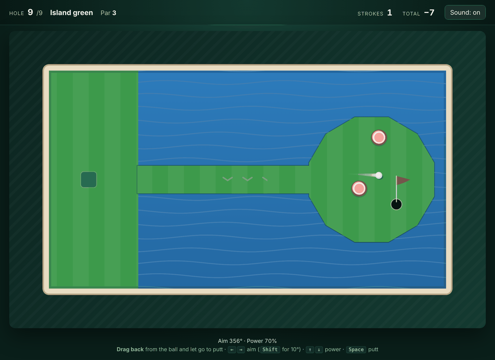
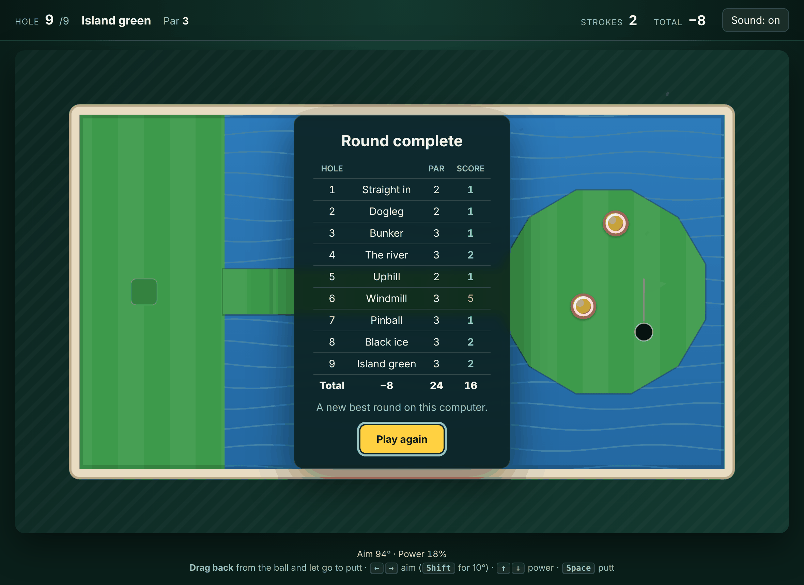

# 07 · Pocket Links: mini golf in the browser

[](https://github.com/DDSC0420/coding-portfolio/actions/workflows/mini-golf.yml)

Nine holes of mini golf: sand, ice, a hill, a river with a bridge, bumpers, a windmill and an island green. Drag back from the ball and let go, or play it entirely from the keyboard.

Under it is a small 2D physics engine written for it (TypeScript, no game library) that is **deterministic**: the same shots always play out exactly the same, to the last bit, in the browser and in the tests. That's what lets the tests prove every hole can be finished in par, by replaying a known way round.



## Try it (runs on your machine, about a minute)

With Node 20.19 or newer:

```bash
git clone https://github.com/DDSC0420/coding-portfolio
cd coding-portfolio/07-mini-golf
npm install
npm run dev
```

Then open <http://localhost:5173>.

- **Mouse or touch:** press anywhere, pull back away from where you want the ball to go, and let go. The further you pull, the harder the putt (the dotted line shows direction and strength).
- **Keyboard:** <kbd>←</kbd> <kbd>→</kbd> aim by 1° (hold <kbd>Shift</kbd> for 10°), <kbd>↑</kbd> <kbd>↓</kbd> power, <kbd>Space</kbd> to putt, <kbd>Enter</kbd> for the next hole. The exact aim is always shown under the course.
- Water costs a stroke and puts you back where you played from. Seven strokes is the limit on a hole. Your best round is remembered on this computer.

`npm run build` makes a static `dist/` folder that runs from any web server (it isn't hosted anywhere; see the repo's rules).



## How it works

**A fixed step.** The physics always advances in steps of exactly 1/240 s, however fast the screen refreshes. Each frame runs as many whole steps as the elapsed time allows and draws the ball part-way between the last two positions, so motion is smooth at 60 Hz and 144 Hz alike ([`loop.ts`](src/loop.ts)). After a stall (the tab in the background) it catches up at most a quarter of a second rather than fast-forwarding through a shot.

**No tunnelling, by construction.** The ball's speed is capped at 1100 px/s, so a step moves it at most 4.6 px, less than its 7 px radius. It can sink into a wall's reach but never past the wall's line, so a plain closest-point test against each wall segment is enough: no fast ball ever passes through a thin wall. The windmill's sails are slow enough that the same holds relative to them. A test fires 3,000 full-speed shots at a 1 px wall to check.

**The physics** ([`physics.ts`](src/engine/physics.ts)): rolling resistance as a constant drag that depends on the surface (sand 6.5× the green, ice a sixth), a little drag proportional to speed, walls that return 72% of the speed into them and keep 96% along them, bumpers that kick back harder than they're hit, slopes as a steady push (a steep one won't let a ball rest on it), and moving sails that bounce the ball relative to their own speed. Over the cup, a slow ball drops and a fast one is pulled round the lip and carries on.

**The rules** ([`game.ts`](src/engine/game.ts)) sit on top as a step-driven state machine: aiming, rolling, holed, picked up. Nothing in the engine reads the clock, the DOM or a random number, which is why it runs identically in Node and in the browser.

**The holes** ([`holes.ts`](src/engine/holes.ts)) are plain data: polygons for walls and ground, a tee, a cup, a par, and a known way round. [`scripts/solve.ts`](scripts/solve.ts) finds those ways round by beam search: every whole-degree angle (2° apart) and a spread of powers, keeping the best few resting places by walking distance to the cup around walls and water. Its first search also showed two holes were trivial, which is why Bunker has a block in the middle and the island green's cup sits behind a bumper.

**Drawing** ([`draw.ts`](src/render/draw.ts)) is a plain 2D canvas: the parts that never move are painted once per hole into an offscreen canvas at twice the resolution; each frame adds the water ripples, slope arrows, sails, ball, trail, aim line and particles. The canvas tracks its displayed size and pixel density, so it stays sharp at any window size. Sounds are synthesised with Web Audio; there are no image or sound files.

## How it's tested

**58 tests**, in CI on every push, plus a strict type check.

| Layer | What it covers |
| --- | --- |
| **Physics** (16) | Stopping distance on the green matches the friction equation solved by hand, to within 1%; sand and ice against the same equation; the speed cap; a head-on bounce returns 72%; an angled bounce leaves at the angle the slide and bounce factors predict; a ball wedged in a corner is pushed out of both walls; 3,000 full-speed shots at a 1 px wall never get through; bouncing never adds speed; the cup takes a slow ball, lets a fast one lip out, and leaves a near miss alone; water, a green patch over water, slopes (a steep one rolls a resting ball the distance the equation gives), bumpers. |
| **Rules and holes** (29) | Each of the nine holes finished in par or better by replaying its stored shots, with the ball never leaving the course; each hole's layout is sane (tee and cup on the green, not in a wall); replays are bit-for-bit identical; a saved state carries on exactly as the original; on the windmill, when you strike changes the result; strokes, the water penalty and return, the seven-stroke limit, moving on and totals, a sail knocking on a resting ball without a stroke. |
| **Controls** (8) | 240 steps per second at 60 Hz and 144 Hz; the stall limit; drag to aim and power, the dead zone; arrow keys and their limits; golf words (birdie, bogey) and totals written as +3, E, −2. |
| **Browser** (5) | Playwright against the production build: the first hole drawn where the data says (turf, cup, ball read back from the canvas pixels); the canvas stays sharp as the window resizes; **a whole round**: hole 1 holed in one with the keyboard and hole 2 holed in one by dragging the mouse (both using the stored solutions, which shows the browser runs exactly the same physics as the tests), holes 3 to 9 played to the stroke limit, the scorecard adding up to 51, the best round saved, play again; the water penalty and return; sound on/off remembered. Any console error fails a test. |

## Honest scope

- **Desktop first.** Touch dragging works (pointer events, no page scrolling on the canvas), but it hasn't been tested on real phones, and the layout is built for a landscape screen.
- **Top-down 2D.** The ball slides rather than spins: no backspin, no curve, no ball in the air. Slopes are flat zones with a constant push, not a height map.
- **The physics is tuned to feel right, not measured from a real course.** The numbers (friction, bounce) were picked for play; the tests check the code does what those numbers say.
- **The windmill is the only moving part,** and it keeps turning while you aim, so timing matters there. Its solution in the tests strikes at an exact physics step, which a person can't do; a straight putt at a random moment gets past the sails a little over half the time, and watching them does better.
- Nine fixed holes, one player, no level editor, no online scores. The best round is in this browser's local storage.
- Tested in Chromium. Firefox and Safari should run it (it uses only standard canvas, pointer and Web Audio APIs), but the tests don't run there.

## Layout

```
src/engine/   types.ts, physics.ts, game.ts, holes.ts: the simulation, pure TypeScript
src/render/   draw.ts (canvas), effects.ts (particles)
src/          main.ts (wiring), loop.ts (fixed step), aim.ts, scoring.ts, audio.ts, style.css
test/unit/    Vitest
test/browser/ Playwright
scripts/      solve.ts (finds the stored solutions), screenshot.mjs
```

## Development

```bash
npm install
npm run typecheck && npm test           # strict TypeScript, unit tests (about 2 s)
npx playwright install chromium         # once
npm run test:browser                    # builds, serves the build, plays it
node scripts/solve.ts 6                 # re-solve a hole after changing it (Node 22.18+)
npm run screenshot                      # regenerate docs/
```

In development, `?hole=6` starts at hole 6.
