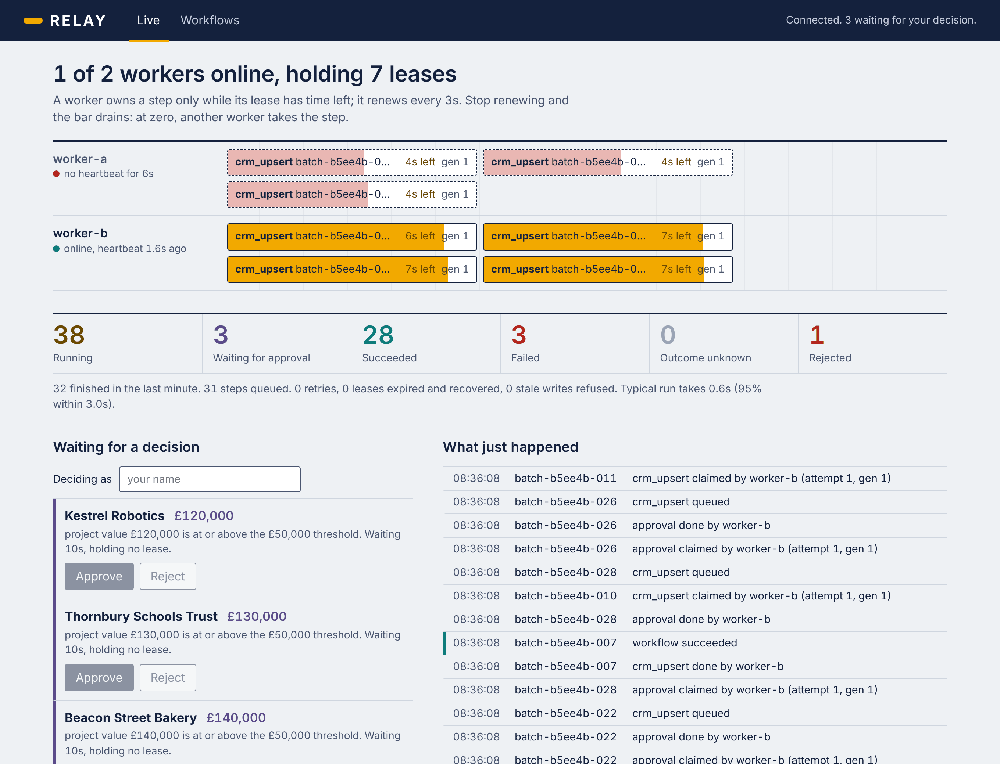
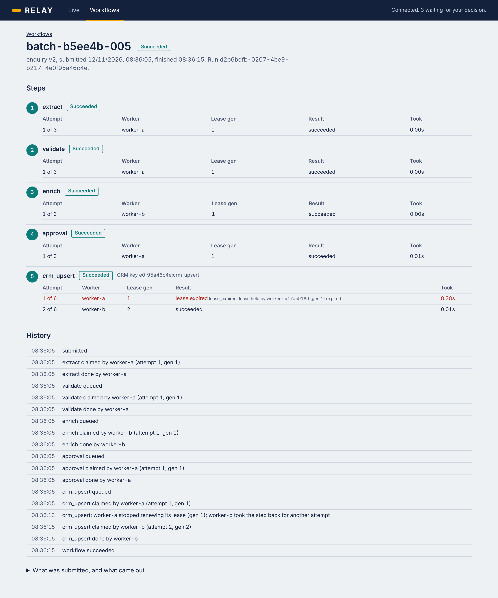

# 08 · RELAY: a workflow engine you can kill mid-step

[](https://github.com/DDSC0420/coding-portfolio/actions/workflows/relay.yml)

RELAY runs multi-step business workflows across several worker processes and keeps going when things break: a worker is killed mid-step, a worker freezes and wakes up late, the service it calls saves a change and then loses the reply. Every step is recorded in PostgreSQL, work is handed out on time-limited leases, and a worker that has lost its lease cannot write.

It's a small engine written from scratch (Python, FastAPI, PostgreSQL; no Celery, no Temporal) to understand how those tools work, with a live dashboard to watch it happen. It is **at-least-once, not exactly-once**, and it is a portfolio project, not production software.



## Try it (Docker, about three minutes)

With Docker Desktop running:

```bash
git clone https://github.com/DDSC0420/coding-portfolio
cd coding-portfolio/08-relay
docker compose -f compose.yaml -f compose.demo.yaml up -d --build
```

Open <http://127.0.0.1:8080>. Then:

1. Press **Send 43 enquiries**. Steps are claimed, completed and handed on; 36 succeed, 3 fail validation, 4 stop at **Waiting for a decision**.
2. Type your name and **Approve** one, **Reject** another. The approved one goes on to the CRM; the rejected one never touches it.
3. Under **The CRM the workflows call**, press **Lose 40% of replies** (the CRM saves the contact, then drops the connection) and send another batch. Retries appear in the feed. The line underneath still says **0 applied twice**.
4. Mid-batch, in a terminal: `docker compose kill worker-a`. Its lease bars drain with nobody renewing them; at zero, worker-b takes each step. `docker compose start worker-a` brings it back.
5. Click any reference to see its steps, every attempt, which worker made it, and with which lease generation.

Or let a script do all of that and check the result:

```bash
uv run python scripts/demo.py     # needs uv: https://docs.astral.sh/uv/
```

It makes the CRM unreliable, submits 65 enquiries, kills worker-a while it holds leases, waits for worker-b to finish alone, decides the approvals, then runs twelve checks across both databases. It exits non-zero if anything was lost or written twice. CI runs exactly this against the Compose stack on every push.

`docker compose stop` keeps the data; `docker compose down -v` deletes it. Everything binds to 127.0.0.1 only.



## How it works

The demo workflow handles a sales enquiry: `extract → validate → enrich → approval → crm_upsert`. The CRM is a separate service with its own database, so "the CRM saved it but the engine never heard" is a state that really occurs.

**PostgreSQL is the queue.** A worker claims a step with `SELECT … FOR UPDATE SKIP LOCKED` in a short transaction that commits before the step runs ([claims.py](relay/engine/claims.py)). Two workers polling at once lock different rows instead of waiting for each other. No broker, so there's no second system that has to agree with the database.

**A claim is a lease.** It has an owner (that worker process, not just its name), an expiry in database time, and a generation number that goes up by one on every claim. The worker renews it every third of its length. Stop renewing, for any reason, and any worker's recovery sweep takes the step back when it expires ([recovery.py](relay/engine/recovery.py)).

**Every write is fenced.** Completing, failing, renewing or pausing a step is an `UPDATE … WHERE` the step is still running, owned by this worker, at this generation, with time left ([leases.py](relay/engine/leases.py)). A worker that was frozen and wakes up late matches no row and writes nothing. That's what stops a stale worker overwriting whoever took over.

**Finishing a step and queuing the next is one transaction** ([transitions.py](relay/engine/transitions.py)), so no crash can leave a workflow stranded between steps.

**Fencing can't recall an HTTP request**, so the CRM call carries an idempotency key that is fixed when the workflow is submitted. The CRM applies each key at most once and replays the stored answer on a retry ([service.py](services/demo_crm/service.py)). That only works because the receiver cooperates; against an API with no such contract, RELAY could not prevent a duplicate, and says so.

**"We gave up" is not "it didn't happen."** If retries run out after an attempt whose result never came back, the workflow ends as `outcome_unknown`, not `failed`.

**Waiting for a person holds no lease.** An enquiry worth £50,000 or more pauses at the approval gate with nothing to renew and nothing to expire, so it survives a restart of every process. The decision, and making the next step ready, are one transaction; repeating a decision returns the original, the opposite one is refused ([approvals.py](relay/engine/approvals.py)).

**The database enforces the state machine too.** Triggers reject an illegal status change, a lease generation going backwards, a change to a run's pinned version, or a change to a recorded decision, even if the Python has a bug.

The full design, written before the code: [architecture](docs/architecture.md) (state machines, the nine transactions, thirteen invariants, failure scenarios), [what is and isn't guaranteed](docs/guarantees-and-limitations.md), five short [decision records](docs/decisions/), and an [interview guide](docs/interview-guide.md) of questions this project should be able to answer.

## How it's tested

**229 tests** in CI on every push: 224 in Python against a real PostgreSQL, 5 in a real browser. Then the Compose demo above.

| Suite | Count | What it proves |
| --- | ---: | --- |
| Unit | 43 | Parsing, validation, the approval rule, backoff and jitter, error classification, the "budget of at least 2" rule. |
| Integration (real PostgreSQL) | 158 | The triggers accept exactly the legal transitions (105 cases). 12 claimers × 40 rounds never claim the same step. A stale worker's completion, renewal and pause are refused. 8 simultaneous recovery sweeps recover 30 steps exactly once. 16 simultaneous approval decisions produce exactly one. A v1 run stays v1 after v2 is published. The verifier catches each kind of corruption when the data is broken on purpose. |
| End to end (real processes) | 8 | API, CRM and two workers over HTTP: a batch across both workers; an approval that survives stopping every process; a rejected enquiry never reaches the CRM. |
| Fault injection (real processes) | 15 | A worker killed (SIGKILL) after claiming, and after the CRM saved but before recording it; a worker frozen (SIGSTOP) past its lease then resumed; CRM replies dropped, 500s and timeouts after saving; a full restart mid-batch; a crash on each of the four steps. Each ends with one CRM write per workflow. |
| Browser (Playwright) | 5 | The dashboard against the real stack: counts match the API; approve and reject from the page; and a worker killed mid-batch while the page watches, with 24 of 24 finishing and none written twice. |

Twelve deliberate bugs were put into the engine one at a time (a fence without the generation check, a claim without the row lock, a decision without its lock, and so on); each made at least one test fail.

Two bugs were found by looking rather than by a test, and now have tests:

- **A crash failed a valid enquiry.** A screenshot showed a run marked *failed* because worker-a died holding `validate`, whose retry budget was 1, and a crash uses an attempt. Every step now needs a budget of at least 2 (the code refuses less), with a crash test per step.
- **"5 stale writes refused" on a healthy system.** The renewal thread was racing its own worker's completion and logging the lost race as a refused write. Harmless, but it made a real signal noisy.

## Benchmark

`uv run python scripts/benchmark.py --workflows 1200`, on a 2-CPU Linux sandbox with PostgreSQL, the CRM and the workers all sharing those two CPUs. One workflow is four claims, four fenced completions and one HTTP call.

| Workers | Slots | Workflows | Time | Workflows/s | Steps/s | Step p50 | Step p95 |
| ---: | ---: | ---: | ---: | ---: | ---: | ---: | ---: |
| 1 | 4 | 1200 | 20.06 s | 59.8 | 239.2 | 6.7 ms | 18.3 ms |
| 2 | 8 | 1200 | 16.91 s | 70.9 | 283.8 | 10.2 ms | 35.9 ms |
| 4 | 16 | 1200 | 17.37 s | 69.1 | 276.3 | 20.4 ms | 80.2 ms |

Every run: all 1,200 succeeded, one CRM write each, invariants hold. The honest reading: on this machine a second worker bought 19% and four were no better than two, because everything competes for the same two CPUs and one database. It shows more workers don't lose or double work; it does not show how far this scales.

## Honest scope

- **At-least-once, not exactly-once.** A step can run twice. The steps are written to be safe to repeat, and the CRM deduplicates. Without a cooperating receiver there is no protection against a duplicate external effect.
- **Not production-ready.** No authentication (reviewer names are labels: anyone who can reach the API can approve), no TLS, no backups or failover, one database that is also a single point of failure.
- **Sequential workflows only:** one step at a time, no branches, no parallel steps, no timers, no child workflows. Steps are Python functions registered in code.
- **Persisted step outputs, not replay.** This is not Temporal's model; a finished step's output is stored and reused.
- A worker that loses its lease can't be interrupted: its step runs to the end and the result is refused.
- No operator "retry this run" for a `failed` or `outcome_unknown` workflow.
- "Extraction" is deterministic rules over synthetic enquiries, labelled as such. No AI and no paid service anywhere.
- The dashboard polls once a second. The crash tests that freeze a process need Linux or WSL2 (they skip on native Windows).
- **Built with heavy AI assistance** (Claude wrote the code), stage by stage from a design written first. The point of the project is that the design and every claim above can be explained and defended; the interview guide is there for that.

## Layout

```
relay/engine/      claims, leases (the fence), transitions, recovery, retries, approvals, submission
relay/workflows/   the registry, enquiry v1 and v2      relay/steps/   the five step handlers
relay/verify.py    twelve invariant checks across both databases
services/          api (control + operations API), worker, demo_crm (with fault switches)
migrations/        hand-written Alembic migrations, including the guard triggers
web/               the dashboard (React, TypeScript, Vite) and its Playwright tests
scripts/           demo, verify, benchmark, run_local (the stack without Docker)
tests/             unit, integration, e2e, fault_injection
docs/              architecture, guarantees and limitations, decisions, interview guide
```

## Development

```bash
docker compose up -d engine-db           # a PostgreSQL for the tests (or set RELAY_TEST_ADMIN_URL)
uv sync
uv run pytest                            # 224 tests, about 90 s
uv run ruff check . && uv run ruff format --check .
uv run python scripts/run_local.py       # the stack as plain processes, API on :8000
cd web && npm ci && npm run dev          # dashboard on :5173
cd web && npx playwright install chromium && npm test
```

On Windows, run the tests from WSL2 to include the process-freezing tests.
