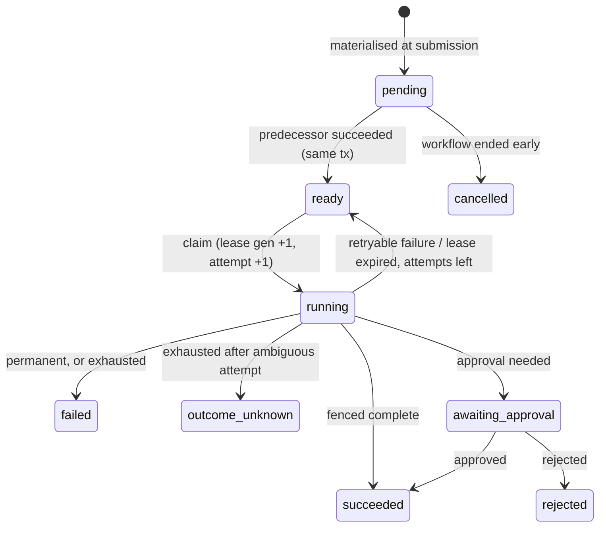

# RELAY architecture

This is the Stage 0 design, kept up to date as the code changed. Everything
described here is built and tested.

RELAY is a small workflow engine. It runs a predefined, versioned, sequential
workflow across several worker processes, stores every step's progress in
PostgreSQL, and recovers work when a worker dies. It is **durable step
execution with persisted outputs**: a completed step's output is saved and
reused; nothing is replayed. It is not a reimplementation of Temporal's
deterministic replay model, and it is not production-ready.

## 1. Components

```
                 ┌────────────────────┐
   browser ────▶ │ web dashboard      │
                 └─────────┬──────────┘
                           │ HTTP (polling)
                 ┌─────────▼──────────┐        ┌──────────────────┐
   scripts ────▶ │ control API        │──SQL──▶│ engine-db        │
                 │ (FastAPI)          │        │ PostgreSQL       │
                 └────────────────────┘        │ queue, state,    │
                                               │ events, workers  │
                 ┌────────────────────┐        └────────▲─────────┘
                 │ worker-a / worker-b│──SQL (claim,     │
                 │ (Python processes) │   fenced writes)─┘
                 └─────────┬──────────┘
                           │ HTTP + Idempotency-Key
                 ┌─────────▼──────────┐        ┌──────────────────┐
                 │ demo CRM (FastAPI) │──SQL──▶│ crm-db           │
                 └────────────────────┘        │ PostgreSQL       │
                                               └──────────────────┘
```

| Component | Owns | Never does |
|---|---|---|
| Control API | Workflow submission, reads, approval decisions | Execute steps |
| Worker | Claiming, executing, completing/failing steps, lease renewal, recovery sweeps | Hold a DB transaction during step execution |
| Engine DB | Source of truth for workflow, step, attempt, approval, event and worker state | — |
| Demo CRM | Contacts, idempotency records, mutation log | Share a transaction with the engine |
| CRM DB | CRM state only | — |

The engine and CRM use **separate databases**. PostgreSQL cannot run one
transaction across two databases, so "the CRM committed but the engine did
not record it" is a real, reachable state — which is the point of the demo.

## 2. State machines

### 2.1 Workflow run

| From | To | Trigger | Transaction |
|---|---|---|---|
| — | `running` | Submission | T1 |
| `running` | `awaiting_approval` | Approval step decides a decision is needed | T4a |
| `awaiting_approval` | `running` | Approved | T7 |
| `awaiting_approval` | `rejected` | Rejected | T7 |
| `running` | `succeeded` | Last step completes | T4 |
| `running` | `failed` | A step fails definitively | T5 / T6 |
| `running` | `outcome_unknown` | Retries exhausted on an external-effect step after an ambiguous attempt | T5 / T6 |

Terminal: `succeeded`, `failed`, `outcome_unknown`, `rejected`.

`outcome_unknown` exists because "we gave up" is not the same as "it didn't
happen". If a CRM call timed out and every retry also failed, the CRM may
still have applied the change. RELAY says so instead of claiming failure.

### 2.2 Step run



| From | To | Trigger | Guard | Tx |
|---|---|---|---|---|
| `pending` | `ready` | Predecessor succeeded or approval granted | Successor is `pending` | T4, T7 |
| `ready` | `running` | Claim | `next_eligible_at <= now()`, row not locked by another claimer | T2 |
| `running` | `succeeded` | Worker completes | Fence (see §4) | T4 |
| `running` | `ready` | Retryable failure | Fence; `attempt_count < max_attempts` | T5 |
| `running` | `ready` | Lease expired | `lease_expires_at < now()`; attempts left | T6 |
| `running` | `failed` | Permanent failure, or attempts exhausted | Fence (T5) or expiry (T6) | T5, T6 |
| `running` | `outcome_unknown` | Exhausted with an ambiguous attempt | as above | T5, T6 |
| `running` | `awaiting_approval` | Approval rule fires | Fence | T4a |
| `awaiting_approval` | `succeeded` / `rejected` | Decision | Approval is `pending` | T7 |
| `pending` | `cancelled` | Workflow reached a terminal non-success state | — | T5, T6, T7 |

### 2.3 Step attempt

One row per claim. `in_progress` → `succeeded` | `failed` | `lease_expired` |
`paused_for_approval`. Only the owner of that attempt's lease
generation, or the recovery sweep after expiry, may set the outcome.

In v1 `attempt_number` and `lease_generation` always move together (every
claim increments both). They are kept separate on purpose: the attempt number
is the retry budget; the generation is the fencing token. An operator "requeue
with a fresh budget" feature would reset one but must never reset the other.

### 2.4 Error classes

| Class | Meaning | Retried? |
|---|---|---|
| `permanent` | Retrying cannot help (validation error, HTTP 400/409/422) | No |
| `transient` | Definitely not applied; may succeed later (connect refused, HTTP 503 from the demo CRM, 429) | Yes, with backoff |
| `ambiguous` | Request may have been applied (read timeout, connection dropped after send, HTTP 500) | Only because the CRM honours idempotency keys |
| `lease_expired` | Worker vanished mid-attempt | Yes; counts as ambiguous for external-effect steps |

Retry timing is in `relay/engine/retries.py`: exponential backoff with equal jitter
(half fixed, half random), capped at `RELAY_RETRY_MAX_DELAY_SECONDS`, never shorter
than a server's `Retry-After` (itself capped at 120 s).

## 3. Transaction boundaries

Each row is one short PostgreSQL transaction. Nothing waits on the network,
a sleep or a human while a transaction is open.

| Tx | Who | Does, atomically |
|---|---|---|
| T1 submit | API | Insert workflow run (with submission key + request hash), insert **all** step rows from the pinned definition (first `ready`, rest `pending`), append `workflow.created` |
| T2 claim | Worker | `SELECT … FOR UPDATE SKIP LOCKED` one eligible step; set `running`, owner, `lease_generation+1`, `lease_expires_at = now() + lease`, `attempt_count+1`; insert attempt row; append `step.claimed`. **Commit before executing.** |
| — execute | Worker | No transaction. Step code runs, possibly calling the CRM over HTTP |
| T3 renew | Worker | Fenced `UPDATE … SET lease_expires_at = now() + lease` |
| T4a pause | Worker | Fenced update to `awaiting_approval`, releasing the lease; close attempt as `paused_for_approval`; insert the approval request with the output the step will hand on; workflow → `awaiting_approval` |
| T4 complete | Worker | Fenced update to `succeeded` with output; close attempt; append event; **make the successor `ready` with this output as its input, or finish the workflow** |
| T5 fail | Worker | Fenced; close attempt; schedule a retry or mark terminal, cancel pending steps, finish the workflow |
| T6 recover | Any worker's sweep | `SKIP LOCKED` batch of expired `running` steps; close their attempts as `lease_expired`; back to `ready` or terminal |
| T7 decide | API | Record approval decision; approve → step `succeeded` + successor `ready`; reject → `rejected` + cancel + workflow `rejected` |
| T8 CRM apply | CRM | Claim idempotency key, check payload hash, apply contact upsert, insert mutation row, store response — **in the CRM database** |

T4 putting "step done" and "next step eligible" in one commit is what stops a
crash between the two from stranding a workflow (invariant I6).

### 3.1 The claim (T2)

```sql
WITH candidate AS (
    SELECT id FROM step_runs
    WHERE status = 'ready' AND next_eligible_at <= now()
    ORDER BY next_eligible_at, id
    LIMIT 1
    FOR UPDATE SKIP LOCKED
)
UPDATE step_runs s
SET status = 'running',
    lease_owner = :worker_id,
    lease_generation = s.lease_generation + 1,
    lease_expires_at = now() + make_interval(secs => :lease_seconds),
    attempt_count = s.attempt_count + 1, ...
FROM candidate WHERE s.id = candidate.id
RETURNING ...;
```

`SKIP LOCKED` means two workers polling at the same instant lock different
rows instead of queueing behind each other; the loser sees nothing and polls
again. `now()` is the database clock, so worker clock skew cannot affect lease
decisions.

### 3.2 The approval gate (T4a, T7)

A paused step holds **no lease**. That is the whole design: there is nothing to
renew and nothing to expire, so no worker is tied up and the recovery sweep
(which only looks at `running` steps) never touches it. A workflow can wait for
a person across restarts of every process.

The decision (T7) locks the approval row `FOR UPDATE`, so two decisions arriving
together are serialised: the second sees the first one's result. Approve writes
the stored output to the step, marks it `succeeded`, puts the workflow back to
`running` and makes the successor `ready`, all in the transaction that records
the decision — the same hand-off a worker's completion does (I6). Repeating a
decision returns the original (`Idempotent-Replayed: true`); the opposite
decision is a 409.

### 3.3 Lock ordering

Transactions lock step rows first (in position order), then the workflow row.
Because a workflow is sequential, at most one of its steps is active at a time
(I1), so two workers never contend for the same workflow's rows in practice.

## 4. Ownership and fencing

A worker's write is accepted only if it still owns the lease it was given:

```sql
UPDATE step_runs SET status = 'succeeded', ...
WHERE id = :step_id
  AND status = 'running'
  AND lease_owner = :worker_id
  AND lease_generation = :generation
  AND lease_expires_at > now()
```

Zero rows updated means the lease is gone (expired, and possibly re-claimed
with a higher generation). The worker rolls back and writes nothing except an
append-only `step.stale_write_rejected` audit event.

**What fencing does not do:** it cannot stop a stale worker from *sending* an
HTTP request to the CRM. Fencing protects engine state. The CRM's
idempotency-key contract is what protects the CRM from duplicate effects.

`lease_owner` is a per-process instance id (`worker-a/7f3c…`), not the
container name, so a restarted `worker-a` can never renew or complete a lease
held by its previous incarnation.

## 5. Invariants

| # | Invariant | Enforced by |
|---|---|---|
| I1 | At most one `ready`/`running`/`awaiting_approval` step per workflow | Partial unique index `uq_step_runs_one_active` |
| I2 | A step is `running` ⇔ it has a lease owner and expiry | `CHECK` constraint |
| I3 | Lease generation only increases | Claim is the only writer (`+1`); tested |
| I4 | Every worker write is fenced on owner + generation + unexpired lease | Code; tested by stale-worker tests |
| I5 | A `succeeded` step is never re-executed | Claim selects only `ready` |
| I6 | Step completion and successor eligibility commit together | T4 is one transaction; tested |
| I7 | At most one CRM mutation per idempotency key | `UNIQUE` on `crm.mutations.idempotency_key` |
| I8 | Reusing an idempotency key with a different payload is rejected | Stored request hash, HTTP 409 (API and CRM) |
| I9 | A run's workflow version and step list never change after submission | Steps materialised in T1; handlers resolved by `(type, version, step)` |
| I10 | No transaction is open while a step executes | Code structure: T2 commits, execution, then T4/T5 |
| I11 | A terminal workflow has no non-terminal steps | T5/T6/T7 cancel pending steps; checked by the verifier |
| I12 | An approval decision is final | `FOR UPDATE` on the approval row in T7; trigger `approvals_guard` rejects any change to a decided row |
| I13 | One worker crash cannot fail a workflow | Every step's `max_attempts` is at least 2 (`StepDefinition` refuses less) |

`relay/verify.py` re-checks these against the live rows of both databases (twelve
queries; `scripts/verify.py`). It is run after the demo, after every benchmark run, and in CI.

## 6. Idempotency

**Submission (API).** `POST /workflows` accepts an `Idempotency-Key` header.
The request hash is SHA-256 of canonical JSON (sorted keys, no whitespace) of
the workflow type, version and input. Same key + same hash returns the
original run (HTTP 200). Same key + different hash returns 409.

**CRM (receiver side).** Each CRM step gets a stable key when its row is
created: `relay:<workflow_run_id>:crm_upsert`. Every attempt reuses it, and the
payload is derived only from persisted step input, so retries send byte-for-byte
equivalent requests. Inside one CRM transaction (T8):

1. `INSERT INTO idempotency_keys … ON CONFLICT DO NOTHING`. A concurrent
   request with the same key blocks on the unique index until the first
   commits or rolls back.
2. If the key already existed: compare request hashes → 409 on mismatch,
   otherwise return the stored response with `Idempotent-Replayed: true`.
3. Otherwise apply the upsert, insert the mutation row, store the response, commit.

Idempotency records are kept for the full demo lifecycle; deleting them would
reopen the duplicate window. Any real retention period must exceed the longest
time a retry can still arrive.

## 7. The external side-effect failure window

```mermaid
sequenceDiagram
    participant W as worker-a
    participant E as engine-db
    participant C as demo CRM
    W->>E: T2 claim (gen 1), commit
    W->>C: POST /contacts/upsert (key K)
    C->>C: T8 apply + store response, commit
    Note over W: worker dies (or response lost)
    Note over E: lease expires
    participant W2 as worker-b
    E-->>W2: recovery → ready; T2 claim (gen 2)
    W2->>C: POST /contacts/upsert (key K, same payload)
    C-->>W2: stored response, Idempotent-Replayed: true
    W2->>E: T4 complete (gen 2), commit
```

One mutation in the CRM, one success in the engine, two attempts recorded.
This works only because the CRM implements the key contract. Against an
arbitrary API without one, RELAY could not prevent a duplicate.

## 8. Failure scenarios

| Scenario | Expected behaviour | Test |
|---|---|---|
| Two workers poll the same ready steps | Each step claimed exactly once | `test_competing_workers_never_claim_the_same_step` |
| Worker dies after claim, before execution | Lease expires; recovery re-readies; next attempt runs | `test_worker_killed_after_claim_is_recovered_by_another_worker` |
| Worker dies after CRM commit, before T4 | Retry with same key; CRM replays stored result; one mutation | `test_worker_killed_after_crm_commit_is_retried_and_crm_replays` |
| CRM response lost after commit (drop, 500, timeout) | Ambiguous → retry with same key → replay | `test_lost_crm_response_after_commit_is_retried_and_replayed` |
| Stale worker completes after re-claim | Fenced update affects 0 rows; newer state untouched | `test_stale_worker_cannot_complete_after_lease_was_replaced`, `test_frozen_worker_cannot_overwrite_the_worker_that_took_over` |
| Stale worker renews an expired lease | Renewal affects 0 rows; lease not revived | `test_stale_worker_cannot_renew_an_expired_lease` |
| Healthy worker on a step longer than the lease | Renewal keeps the lease; no recovery | `test_a_step_slower_than_the_lease_keeps_its_lease_by_renewal` |
| Temporary CRM 503s | Backoff with jitter, then success | `test_temporary_crm_outage_recovers_with_backoff` |
| Validation failure | Step and workflow `failed`, no retry, structured errors | e2e batch test |
| Retries exhausted | `failed`, or `outcome_unknown` if any attempt was ambiguous | `test_crm_down_for_good_exhausts_retries_and_fails`, `test_exhausted_retries_*` |
| Several recovery sweeps at once | Each expired step recovered exactly once | `test_concurrent_recovery_sweeps_recover_each_step_exactly_once` |
| Crash between step success and successor scheduling | Impossible by construction (one transaction) | `test_completion_and_successor_scheduling_are_atomic` |
| Full restart with databases kept | In-flight work recovers via lease expiry; nothing lost or duplicated | `test_full_restart_with_work_in_flight_loses_nothing` |
| Approval pending across a full restart | Still pending; approve later continues | `test_an_approval_survives_a_full_restart_then_continues` |
| Stale worker tries to pause a step for approval | Refused by the fence; no approval request created | `test_a_worker_that_lost_its_lease_cannot_pause_the_workflow` |
| Two reviewers decide at once, or one decides twice | Exactly one decision; a repeat returns it; the opposite is a 409 | `test_sixteen_decisions_at_once_produce_exactly_one` |
| Worker dies holding any step, including `validate` | Recovered and completed by another worker | `test_a_crash_on_any_step_never_fails_a_valid_workflow` |

### 8.1 Recovery timing

A killed worker's step becomes eligible again at most `lease_seconds +
recovery_interval_seconds` after its last successful renewal (defaults 15 s +
2 s; `compose.demo.yaml` uses 8 s + 1 s). Renewals run every `lease_seconds / 3`,
so a healthy worker survives two missed renewals (a slow database round
trip, a brief stall) before its lease is at risk.

## 9. Why PostgreSQL is enough

The queue is a table with a partial index on `ready` steps. `FOR UPDATE SKIP
LOCKED` gives concurrent workers non-blocking claims; transactions give atomic
state transitions; constraints enforce the invariants above. A broker such as
RabbitMQ or Redis would add a second source of truth that must agree with the
database, and the hard problems here (ownership, fencing, idempotency) would
still have to be solved in the database. At this scale — tens of workflows per
second on a laptop — polling a well-indexed table is cheap. See
[ADR 0001](decisions/0001-postgres-queue.md).

## 10. How it was built

| Stage | Delivered | Exit check |
|---|---|---|
| 0 | This design, ADRs | Reviewed |
| 1 | Repo, Compose, migrations, submission API, worker with SKIP LOCKED claims and fenced writes, enquiry workflow, demo CRM with key contract | Integration tests on real PostgreSQL; subprocess end-to-end run |
| 2 | Lease renewal, recovery sweep, retries with backoff + jitter, error classification, `outcome_unknown`, CRM fault controls, failpoints, crash tests with real process death | Fault-injection suite |
| 3 | Approval gate as enquiry v2, version pinning, operations API (overview, metrics, events, approvals, batches) | Approval restart test; version-pinning tests |
| 4 | Dashboard on the real API | Playwright suite that kills a worker mid-batch |
| 5 | Verifier, demo and benchmark scripts, CI including the Docker Compose demo, interview guide | Demo passes from a clean clone in CI |
